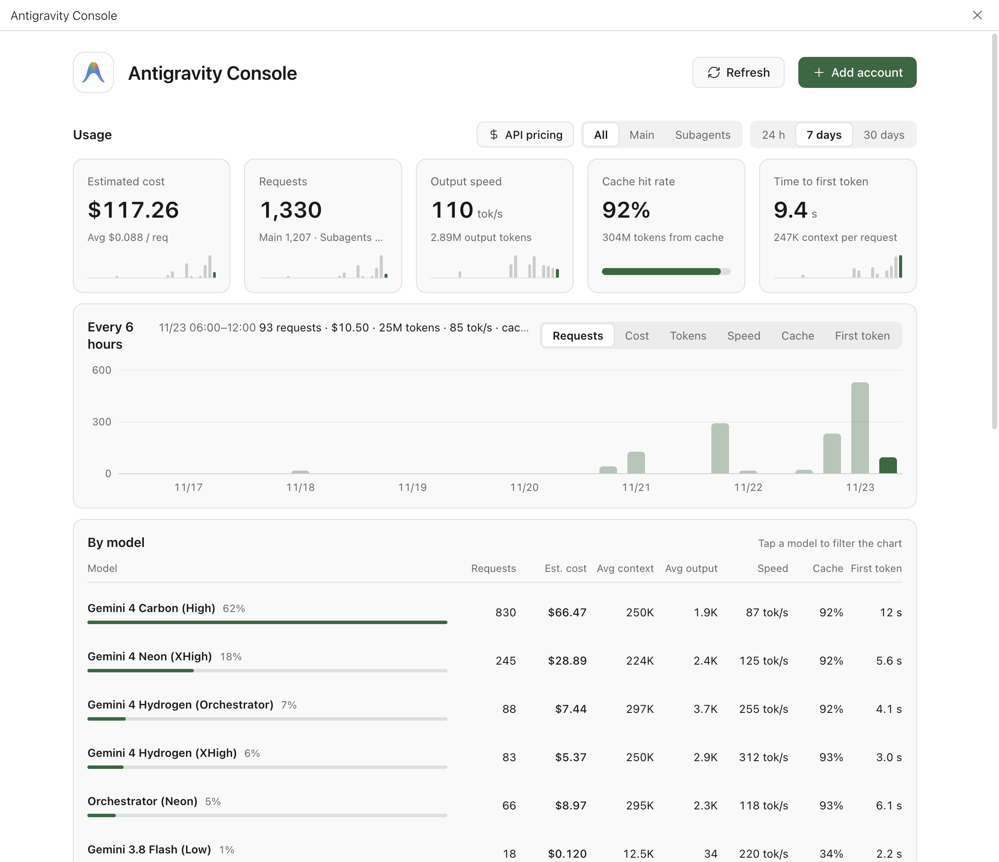
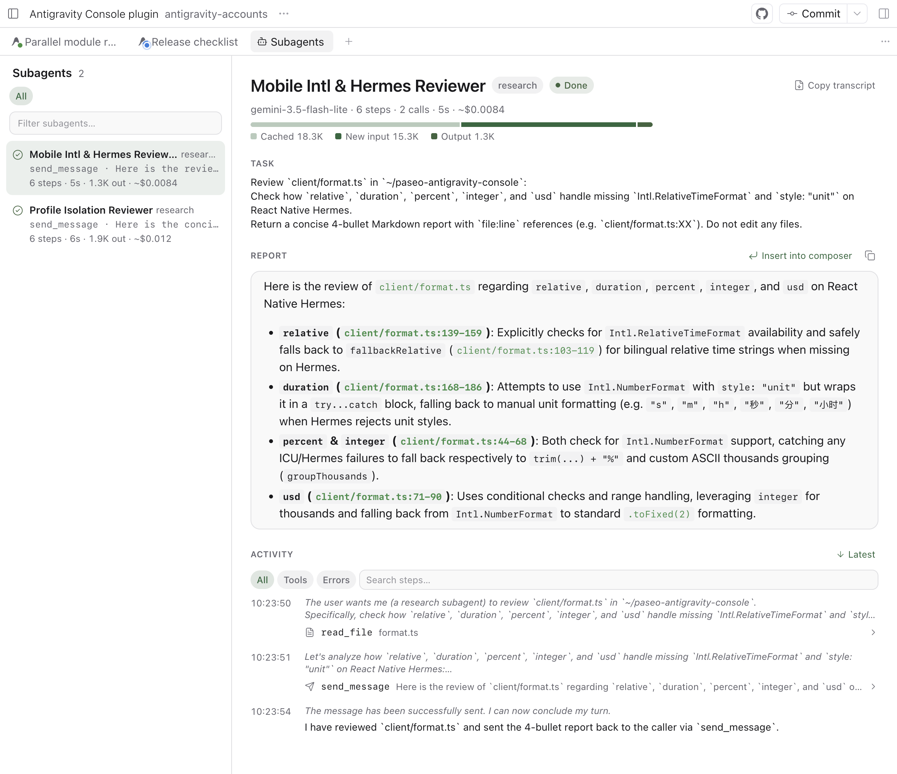
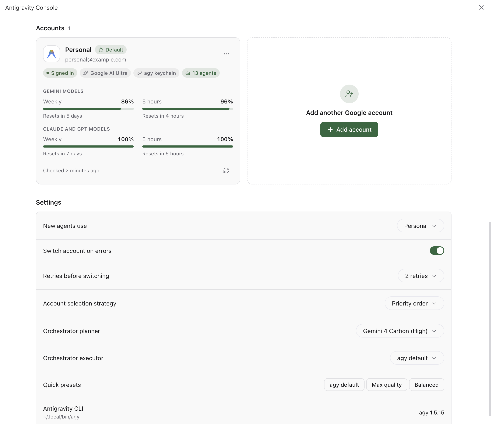

# Antigravity Console for Paseo

A [Paseo](https://paseo.sh) plugin for the built-in Antigravity provider:

- **Multiple Google accounts.** Pick an account per agent, reorder priority, inspect or bulk-migrate active agents on an account, recover files saved in a profile HOME, and switch running agents without losing the conversation.
- **Model-aware automatic fallback.** Failed turns are retried, then continued on the next eligible account that supports the model and has quota in the right pool (Gemini vs Claude/GPT), using priority order, highest remaining quota, or soonest reset. View and clear cooldowns directly on account cards.
- **Quota, usage, and estimated cost.** The Google AI plan, 5-hour and weekly quota of every account, per-request API cost estimates based on official Google rates (with customizable per-model pricing), plus switchable usage charts (requests, cost, tokens, speed, cache hit rate, first-token latency), main vs subagent breakdown, model filtering, and per-account attribution.
- **Subagents.** Live timeline cards, workspace running badges, and a searchable Subagents panel with task, artifacts preview, filterable activity log with auto-scroll, transcript export, and one-click report insertion into the parent composer.
- **Orchestrator models.** Choose the Orchestrator's planner and executor globally (with quick presets), per profile account, from the composer pill, or via `/orchestrator`.
- **Context.** A composer pill with the agent's context window use.





| Subagents in the timeline | Accounts and settings |
| --- | --- |
|  |  |

## Install

Requires Paseo 0.17.1 or later and the Antigravity CLI (`agy` 1.5.13 or later; planner and executor choices need 1.5.14) on the daemon host. Tested on macOS.

```bash
paseo plugin add git:Kel077/paseo-antigravity-console
```

Then open **Antigravity Console** from the Command Center (or click the meters at the bottom of the sidebar) and choose **Add account**.

## How it works

Paseo runs `agy` for every Antigravity agent. This plugin hooks those launches:

- Each extra account gets its own `HOME` under `~/.paseo/plugin-data/antigravity-accounts/profiles/`. It mirrors your real home with symlinks, except for agy's sign-in, which agy keeps there as a file. Conversation folders link back to the real ones, so every account sees the same conversations and an agent can change accounts mid-conversation.
- Before an account launches, the plugin atomically copies `~/.gemini/antigravity-cli/settings.json` into its profile and applies any per-account Orchestrator override.
- Removing an account deletes its sign-in and agy's data for it. Files agents saved in its `HOME` are moved to `~/Antigravity Console/<account name>` first, and the Remove dialog lists them. You can also recover saved files anytime without removing the account.
- Quota comes from `agy -p /usage`, the plan from the sign-in check of `agy acp`, model lists from `agy models`. Paseo's own Antigravity usage source reports the system sign-in and the account each agent runs on; the plugin adds the accounts it created to Paseo's Usage. Usage statistics, context use, and subagents (including artifacts) are read from agy's own records under `~/.gemini/antigravity-cli`.
- Global planner and executor choices are written to the `orchestrator` entry of agy's `settings.json`.

The plugin itself makes no network requests and never reads the keychain. See [OVERVIEW.md](OVERVIEW.md) for the full list of what it reads and writes, and its limits.

## Development

```bash
npm install
npm run typecheck
paseo plugin add "$PWD"                   # install from this folder
paseo plugin reload antigravity-accounts  # after each change
```

The plugin uses only modules Paseo provides at runtime, so it has no runtime dependencies and no build step.

## License

[MIT](LICENSE)

Antigravity and the Antigravity logo are trademarks of Google LLC. This project is not affiliated with or endorsed by Google or Paseo.
