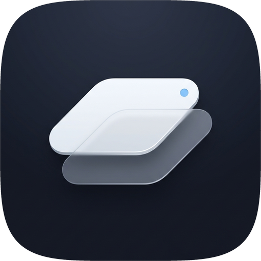
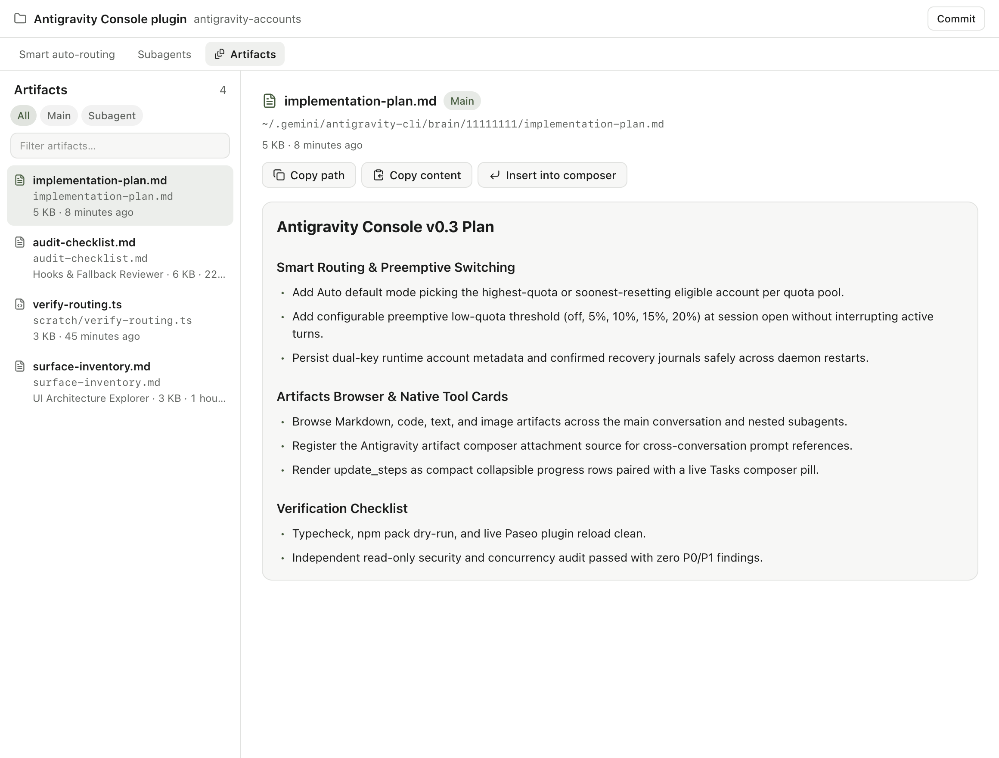
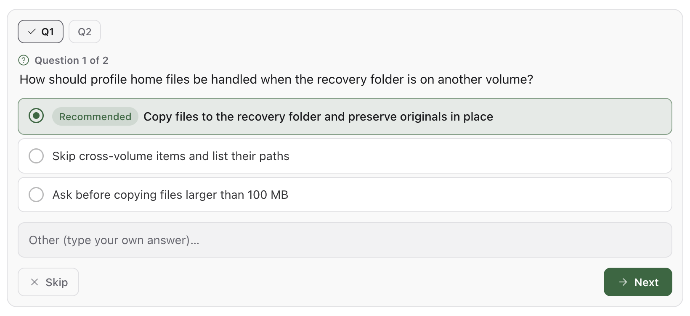
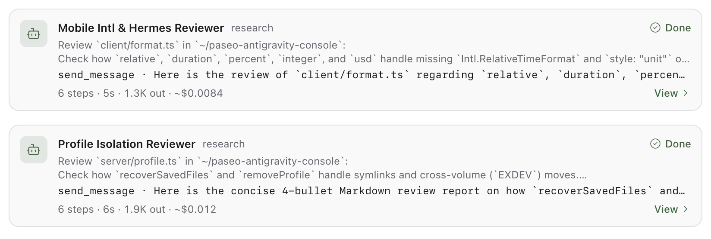

<p align="center">
  
</p>

# Antigravity Console for Paseo

Multi-account management with smart auto-routing, model-aware fallback and proactive low-quota switching, quick sidebar quota popover, API cost & per-conversation analytics, artifacts browser & attachments, subagent inspection, interactive question and task cards, and Orchestrator model control for [Paseo](https://paseo.sh)'s built-in Antigravity provider.

Works across Paseo desktop, web, and mobile (iOS & Android), with English and Simplified Chinese (`zh-CN`) localization.





| Interactive `ask_question` cards | Subagents in the timeline |
| --- | --- |
|  |  |

## Features

- **Multiple Google accounts, notes, & agent migration**
  - Add any number of Google accounts alongside the system sign-in stored in `agy`'s keychain, using a guided browser OAuth code / redirect-URL flow.
  - Add short **notes/tags** (e.g. `Main`, `Claude only`, `Backup Ultra`) to any account, reorder account priority, choose a fixed default or **Auto (pick by strategy)** for new agents, rename accounts, sign in again, sign out, or remove accounts.
  - Switch an active agent's account mid-conversation (**immediately** or **on next session open** without interrupting a running turn) from the composer pill or `/account`, with inline **5H/7D remaining quota** for the active model's pool, cooldown warnings, and **model compatibility indicators**.
  - Inspect all active agents running on an account (**Agents on this account…**), jump straight to any agent, or bulk-migrate agents to another signed-in account (`Switch on next session open`, `Closed agents only`, or `Switch immediately`).
  - Inspect and recover files saved inside a profile account's isolated `HOME` (**Saved home files…**) to `~/Antigravity Console/<account>` at any time without removing the account.

- **Smart auto-routing, model-aware fallback, & proactive low-quota switching**
  - **Auto default mode** automatically selects the best eligible account for each new agent based on your chosen strategy and the model's quota pool (`Gemini` vs `Claude / GPT`).
  - **Proactive low-quota switching** (configurable `5%`–`20%` threshold) switches to a healthier account automatically when creating a new agent or interactively opening a session whose active pool is at or below the threshold, without interrupting a live turn.
  - Classifies failed turns into `quota` (`429` / rate limits), `auth` (`401` / `403`), `transient` (`5xx`, timeouts, network, unexpected exit), and general errors.
  - Retries temporary failures on the current account (`0–3` configurable retries), then switches to the next eligible account and sends `"Continue."` to resume automatically.
  - Three selection strategies: **Priority order**, **Most remaining quota**, or **Soonest quota reset** (spend quota that resets earliest first).
  - Exclude individual accounts from automatic switching (**Manual only**), view active per-pool cooldown countdowns on each account card, and clear cooldowns with one click (**Resume now**). Every retry and switch is recorded inline in the agent timeline.

- **Quick sidebar quota popover & Paseo Usage integration**
  - Displays each account's Google AI plan (such as `Google AI Pro` or `Google AI Ultra` via `agy acp`) and remaining `5h`, `weekly`, `daily`, or `monthly` quota meters with reset countdowns.
  - Adds a compact **Sidebar Footer** bar showing the active default account's `5H` and `7D` remaining quota; clicking it opens a **quick popover** with every account's quota, reset timers, one-click default switch, auto-routing toggle, refresh, and a link to the full Console.
  - Registers all added profile accounts as a Paseo usage source so they appear alongside the system sign-in in Paseo's built-in **Usage** view.

- **Usage analytics, per-session cost, & top conversations**
  - A GitHub-style **daily token calendar** covers the last year (fewer weeks on narrow screens), shaded by quartiles of your active days, with active days, busiest day, average per active day, and current streak. Hover or tap a day for its tokens, requests, and cost.
  - Tracks total tokens (input, cached, and output), estimated USD cost, requests, output speed (`tok/s`), cache hit rate, and time to first token across **24 hours** (hourly), **7 days** (6-hour), or **30 days** (DST-safe calendar days).
  - Filter by **conversation scope** (`All`, `Main`, `Subagents`), **attributed account** (showing per-account request count and cost), or **model** (click any model row to filter the whole dashboard, calendar included).
  - Click a stat tile to chart that metric; hover a bar to read every metric for that period.
  - The per-model table sorts by any column, shows each model's share of the sorted total, and ends with a totals row.
  - **Top conversations** table ranks your highest-cost, highest-token, or busiest conversations in the selected window, displaying titles, workspaces, primary model, attributed account, and one-click jump buttons to active Paseo agents.
  - Built-in official token pricing for Google AI Studio, Anthropic, and OpenAI models (including scheduled rate changes and `>200K` long-context tiers). Open **API pricing** (or click any model's cost) to customize input/cached/output and `>200K` rates, add custom model keys, or reset to official defaults.

- **Artifacts browser & composer attachment source**
  - Dedicated **Artifacts** agent panel lists Markdown, code, text, and image files produced under `~/.gemini/antigravity-cli/brain` by both the main conversation and its subagents, with owner filtering, search, inline Markdown/code/image preview (images up to 2 MB, text up to 256 KB), copy path/content, and one-click insertion into the composer.
  - Registers an **Antigravity artifact** composer attachment source so you can search recent artifacts and subagent reports across conversations and attach them directly to any new prompt.

- **Subagents timeline cards, workspace badges, & inspector panel**
  - Replaces raw `invoke_subagent` tool calls in the timeline with live status cards showing role, type, task preview, current tool or thinking status, step count, elapsed time, output tokens, and estimated cost; condenses `manage_subagents` (`list`, `kill`, `kill_all`) into one-line summaries.
  - Displays a live running-subagent count badge on workspace rows in the sidebar while subagents are active.
  - Dedicated **Subagents** agent panel (split master-detail on desktop, stacked navigation on mobile) with nested hierarchy indentation, search, state filters (`All`, `Running`, `Failed`), token split bar (`Cache`, `New input`, `Output`), expandable task and Markdown report, **Insert into composer** to drop a subagent's report into the parent prompt, **Artifacts** browser with inline Markdown/text preview (up to 256 KiB), filterable step-by-step activity log (`All`, `Tools`, `Errors`, search, `Follow` auto-scroll), and one-click full Markdown transcript copy.

- **Interactive `ask_question` cards & native Antigravity tool renderers**
  - Renders Antigravity's `ask_question` tool calls as interactive choice cards supporting single-select radios, multi-select checkboxes, multi-question tabs, `Recommended` badges, custom `Other` free-text input, **Skip**, and **Edit in composer**.
  - Hides the duplicate plain-text `- [1] ...` list printed by `agy acp`, delivers replies via `steer` so deferred turns resume immediately without interrupting running tools or subagents, and collapses answered or historical cards into compact read-only summaries.
  - Renders each `update_steps` call as a compact expandable progress row (collapsed by default to avoid timeline spam, click to inspect the snapshot) and adds a live **Tasks** composer pill (`done/total`) with the latest confirmed checklist popover.
  - Condenses `schedule`, `run_workflow`, and `send_message` tool calls into compact expandable summary rows.

- **Orchestrator planner & executor control**
  - Choose Antigravity Orchestrator's **Planner** and **Executor** models and reasoning effort globally (saved to `~/.gemini/antigravity-cli/settings.json`), apply one-click **Quick presets** (`agy default`, `Max quality`, `Balanced`), see warnings when signed-in accounts lack a selected model family, or set **Per-account Orchestrator overrides** on individual profile accounts.
  - Adjust on the fly from the composer pill on `gemini-pro-orchestrator*` agents or with `/orchestrator`.

- **Context window meter & current conversation totals**
  - Shows a composer pill (`used / window · %`) and detailed popover (`Cache reads`, `New input`, `Output`, window size source, and last update time) plus **cumulative totals for the current conversation** (requests, total tokens, cache share, and estimated API cost).

## Where to Find Everything in Paseo

| Surface | Entry / Action | Purpose |
| --- | --- | --- |
| **Screen & Settings** | **Command Center** → `Antigravity Console`, **Settings → Antigravity Console**, or **Console** inside the **Sidebar Footer** popover | Full console: Usage, Top conversations & API pricing, Accounts grid, Fallback & Orchestrator settings |
| **Sidebar Footer** | Click the `5H / 7D` quota row | Quick multi-account quota popover, one-click default switch, and auto-routing toggle |
| **Command Center** | `Refresh Antigravity quotas`, `Open Antigravity artifacts` (`⌘K` / `Ctrl+K`) | Re-check sign-in/quota across accounts, or open the current agent's Artifacts panel |
| **Draft Composer** | **Account** selector | Pick `Auto` or a specific Google account (with live 5H/7D quota & notes) for a new agent |
| **Composer Attachments** | **Antigravity artifact** attachment source | Search and attach recent brain artifacts or subagent reports to any prompt |
| **Agent Composer Pills** | **Account**, **Context**, **Tasks**, **Subagents**, **Orchestrator** | Switch account (with pool quota & model compatibility), inspect context & session cost, view live task checklist, open Subagents, or tune Orchestrator models |
| **Agent Panels** | **Artifacts**, **Subagents** | Browse main & subagent Markdown/code/image artifacts, or inspect subagent runs |
| **Slash Command** | `/account [name or number]` | List accounts with notes & remaining quota, or switch the current agent |
| **Slash Command** | `/orchestrator [default\|quality\|balanced\|planner <model>\|executor <model>]` | Inspect or change Orchestrator planner/executor models or apply a preset |
| **Workspace Sidebar** | Running subagents badge | Shows active subagent count per workspace |
| **Agent Timeline** | Subagent cards, Question cards, Compact task progress rows, Compact tool rows, Fallback notes | Live subagent status, interactive `ask_question` forms, collapsible `update_steps` progress, condensed `schedule`/`run_workflow`/`send_message`, and retry/switch audit rows |

## Install

Requires **Paseo `>=0.17.1`** and the **Antigravity CLI** (`agy` `1.5.13` or later; Orchestrator planner/executor settings require `1.5.14`) on the daemon host. Tested on macOS daemon hosts; client UI runs on macOS, web, iOS, and Android.

From the Paseo plugin registry (or **Settings → Plugins** inside Paseo):

```bash
paseo plugin add kel077/antigravity-console
```

Or directly from GitHub:

```bash
paseo plugin add git:Kel077/paseo-antigravity-console
```

Then open **Antigravity Console** from the Command Center (or click the quota meters in the sidebar footer) and choose **Add account**.

## How It Works & Data Access

Paseo launches `agy` for every Antigravity agent. This plugin hooks those launches on the daemon host:

- **Profile isolation**: Each added account gets its own `HOME` under `~/.paseo/plugin-data/antigravity-accounts/profiles/<id>/`. Top-level entries symlink back to your real home folder so agents still see your files and tools, while `agy` stores only that account's file-based sign-in inside the profile instead of the system keychain. Conversation directories link back to `~/.gemini/antigravity-cli`, so all accounts share conversations and agents can switch accounts mid-thread. If credentials ever land outside a profile, the plugin disables that profile to protect the system sign-in.
- **Settings sync & overrides**: Before launching on an added account, the plugin atomically copies `~/.gemini/antigravity-cli/settings.json` into the profile and merges any per-account Orchestrator override. Global Orchestrator choices write the `orchestrator` field of `~/.gemini/antigravity-cli/settings.json`.
- **Safe file recovery**: Files an agent creates directly inside a profile `HOME` can be recovered anytime (or automatically during account removal) to `~/Antigravity Console/<account name>`. When the profile and recovery folders are on different filesystem volumes, recovery copies files while preserving the originals in place, and account removal cleans up verified unchanged entries without following symlinks.
- **Local reads & zero external network traffic**: Quota (`agy -p /usage`), plans (`agy acp`), model lists (`agy models`), and sign-in run the local `agy` binary on the daemon host. Usage statistics, context window meters, and subagent transcripts/artifacts (symlink-checked with `lstat`, preview capped at 256 KiB) read `~/.gemini/antigravity-cli`. Submitting or skipping an interactive question card sends that reply message to the agent through Paseo. The plugin makes **no network requests of its own**, never reads the macOS keychain, and stores its account list, quota cache, custom pricing (`pricing.json`), and conversation-to-account attribution (`conversation-accounts.json`) inside `~/.paseo/plugin-data/antigravity-accounts/`.

See [OVERVIEW.md](OVERVIEW.md) ([简体中文](OVERVIEW.zh-CN.md)) for the full listing summary and known limits.

## Development

```bash
npm install
npm run typecheck
paseo plugin install "$PWD" --id antigravity-accounts   # install from local checkout
paseo plugin reload antigravity-accounts                # reload after edits
paseo plugin logs antigravity-accounts                  # inspect daemon-side logs
```

The plugin uses only runtime modules supplied by Paseo (`react`, `react-native`, `@tanstack/react-query`, `zod`, `@getpaseo/plugin`), so it has zero runtime `dependencies` and no build step.

## License

[MIT](LICENSE)

Antigravity is a trademark of Google LLC. This project is independent and is not affiliated with or endorsed by Google or Paseo.
